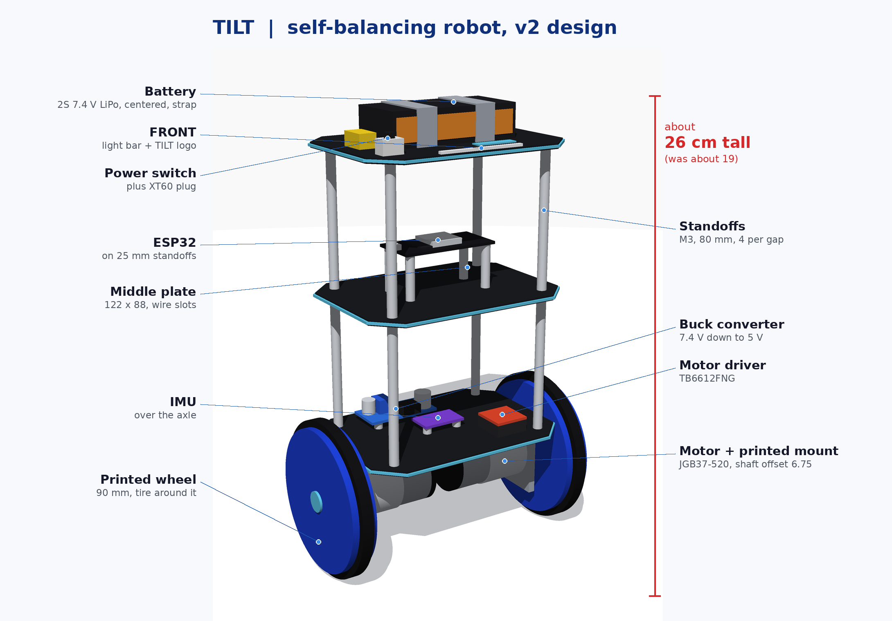

# TILT: a self-balancing robot

Building a two-wheeled self-balancing robot from scratch: ESP32, my own firmware, a 3D-printed frame designed in Onshape, and a custom PCB designed in KiCad. I'm logging everything I learn along the way.

## Where it's at

- [x] Every part tested and measured
- [x] Design locked in (about 26 cm tall, 90 mm wheels)
- [x] First parts printed: motor fit-test plate (fits perfectly) and the middle plate
- [ ] Bottom plate, top plate, motor mounts, wheels
- [ ] Firmware
- [ ] Custom PCB

## Find your way around

| Folder | What's in it |
| --- | --- |
| [design/](design/) | What I'm building: the layout, why I made each choice, and every part measured with photos |
| [cad/](cad/) | My Onshape parts and what's been printed |
| [firmware/](firmware/) | My own code for the robot |
| [pcb/](pcb/) | My KiCad board |
| [log/](log/) | A note for each work session, with screenshots |
| [archive/](archive/) | Older designs (TILT v1) and old guides, kept to show how the design changed |
| [PLAN.md](PLAN.md) | The timeline and what's next |

## Why I'm doing this

I don't want to just follow a tutorial. I want to understand every part of this robot and be able to build the next one on my own. So I'm learning each piece as I go:

- Onshape and 3D printing, so I can print parts to exact measurements
- KiCad, so I can design a PCB and get it manufactured
- Soldering, wiring, and figuring out where everything should go
- Writing my own code for the robot, including I2C, UART, motor control, and PID

## The parts

| Part | What it does |
| --- | --- |
| ESP32 dev board (38-pin) | The brain. Runs the code. |
| MPU-9250/6500 IMU | Measures tilt (accelerometer and gyro) over I2C |
| TB6612FNG motor driver | Takes the ESP32's signals and drives the motors |
| 2x JGB37-520 motors (12 V, 110 RPM) with encoders | Move the wheels and measure how far they turn |
| LM2596 buck converter | Steps the battery's 7.4 V down to 5.0 V |
| 2S LiPo battery (7.4 V, 2200 mAh) | Power |

## Credit

I'm using [anwarminarso/ESP32-SelfBalancing](https://github.com/anwarminarso/ESP32-SelfBalancing) as a reference to learn from. My goal is to write my own code and compare it to theirs, not copy it.
