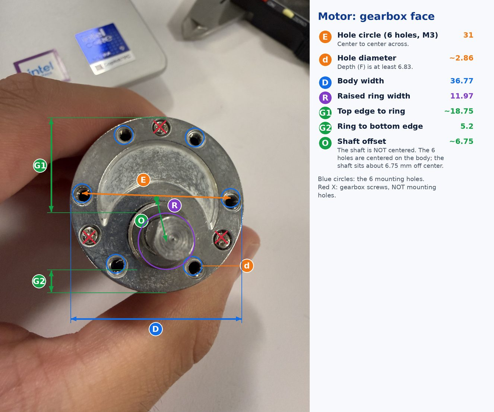
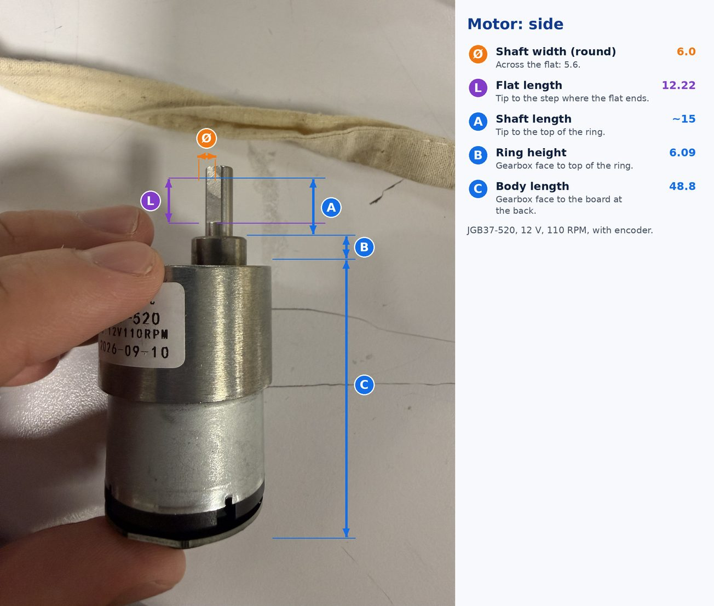
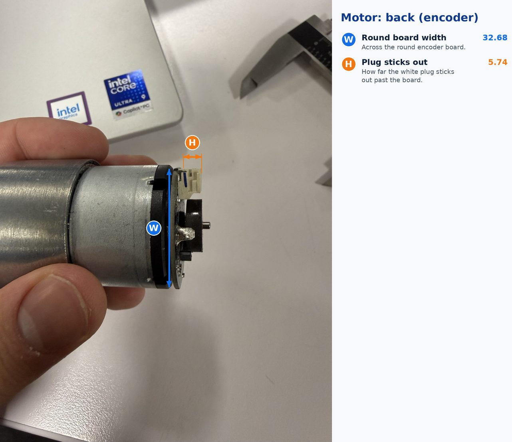
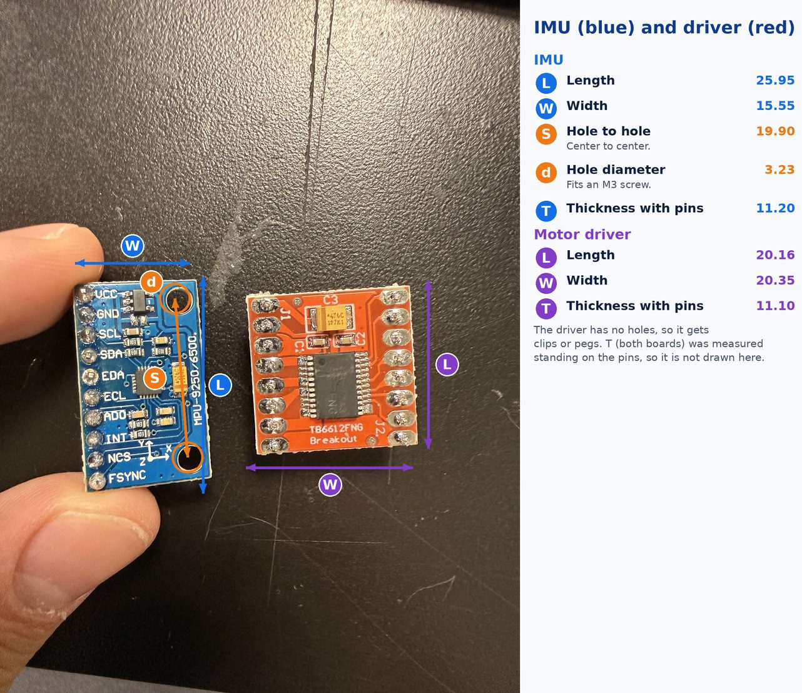
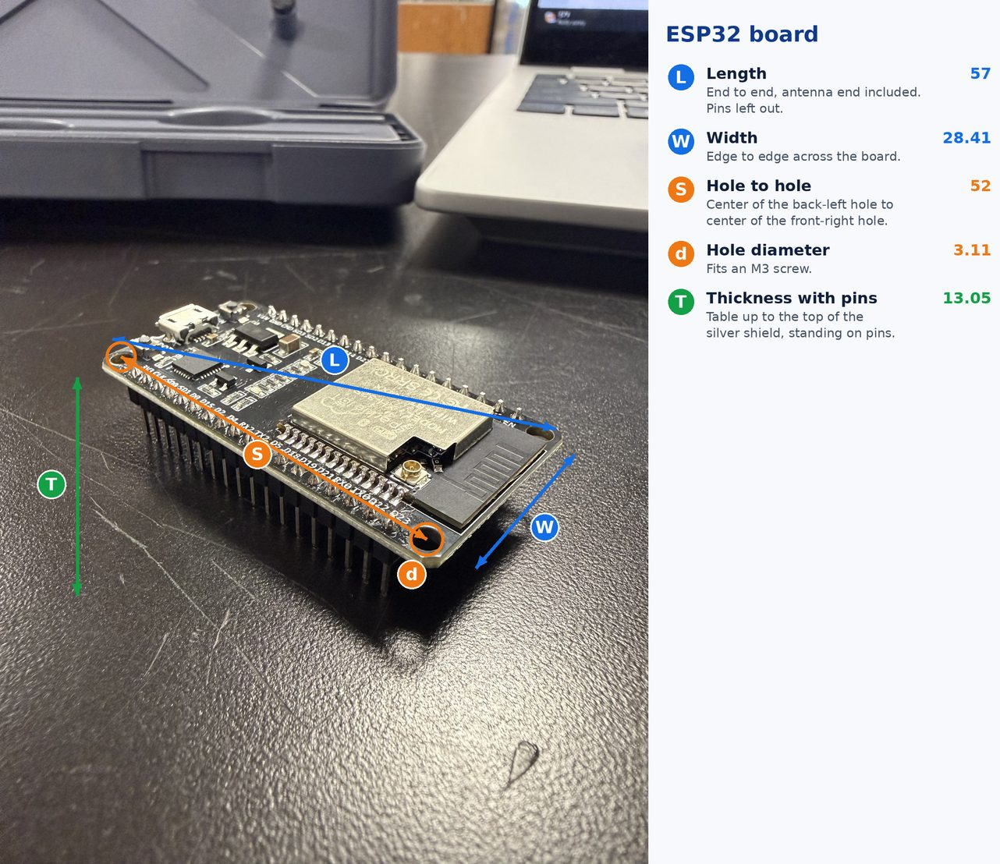
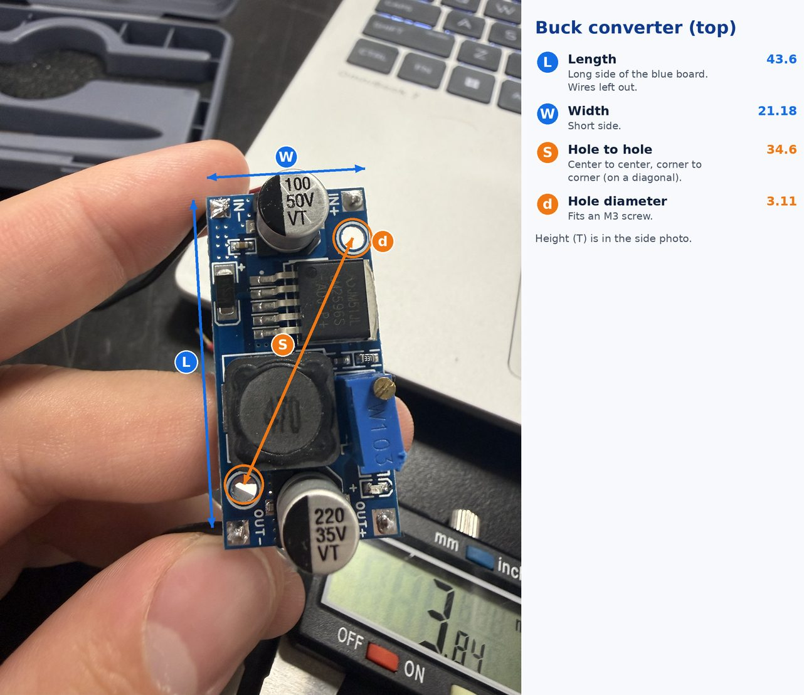
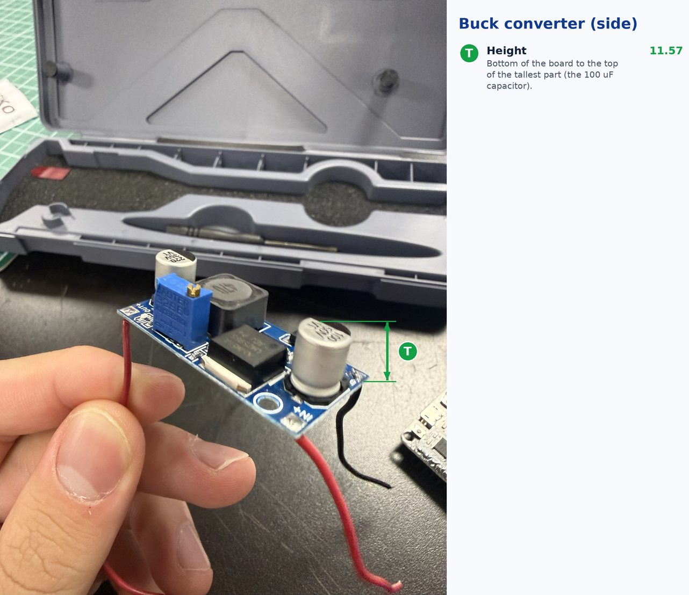
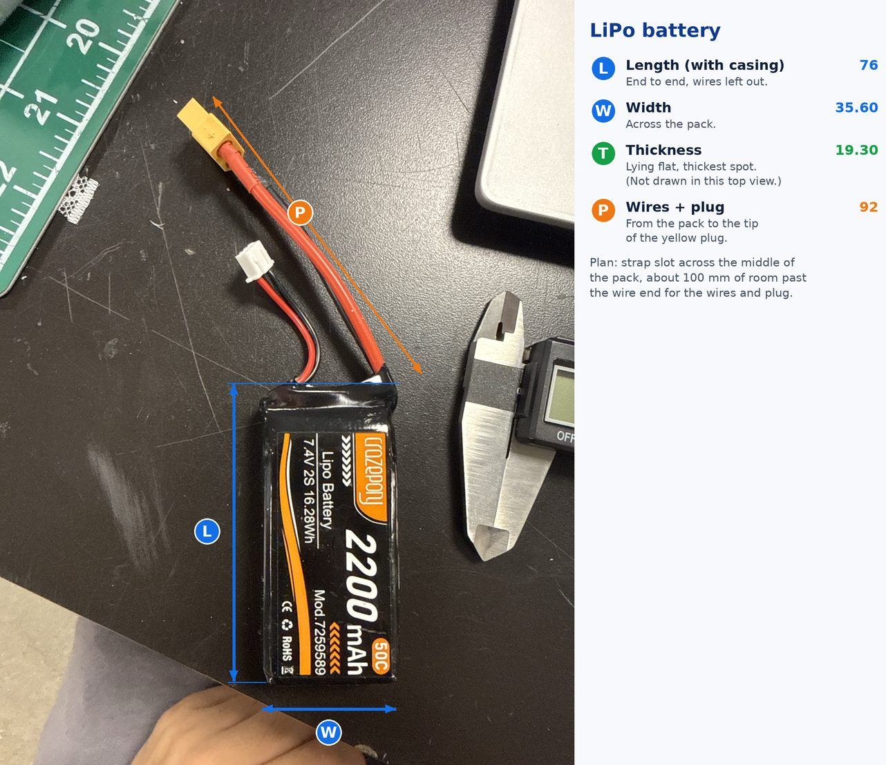

# Measurements

All in mm, measured by me with calipers. Each part has a photo showing where I measured, so the letters in the tables match the letters in the pictures.

## Motor

JGB37-520 (12 V, 110 RPM) with encoder.

| Name | What | Value |
| --- | --- | --- |
| Shaft width (Ø) | round part | 6.0 |
| Flat to round | across the shaft at the flat | 5.6 |
| L | length of the flat on the shaft | 12.22 |
| A | shaft length, tip to top of the ring | about 15 |
| B | ring height above the gearbox face | 6.09 |
| R | diameter of the raised ring | 11.97 |
| C | gearbox face to the board at the back | 48.8 |
| D | motor body width | 36.77 |
| E | mounting holes, center to center across (6 holes, M3) | 31 |
| d | mounting hole diameter | about 2.86 |
| F | mounting hole depth | at least 6.83 (rod too thick to reach the bottom) |
| G1 | top edge of body to top of ring | about 18.75 |
| G2 | bottom of ring to bottom edge of body | 5.2 |
| W | round board at the back, width | 32.68 |
| H | white plug sticks out past the board | 5.74 |

### What I learned

- The 6 mounting holes are centered on the motor body, but the shaft is NOT. It sits about 6.75 mm off center (toward the G2 side). That's the green arrow (O) in the face photo.
- So the mount needs the shaft hole in one place and the 6 holes on a 31 mm circle centered about 6.75 mm away from it.
- The 3 other screws on the gearbox face (red X in the photo) hold the gearbox together. They are not mounting holes.

## IMU and motor driver

| Part | Measurement | mm |
|---|---|---|
| IMU | Length (L) | 25.95 |
| IMU | Width (W) | 15.55 |
| IMU | Thickness with pins (T) | 11.20 |
| IMU | Hole diameter (d) | 3.23 |
| IMU | Hole center to center (S) | 19.90 |
| Driver | Length (L) | 20.16 |
| Driver | Width (W) | 20.35 |
| Driver | Thickness with pins (T) | 11.10 |

The driver has no mounting holes, so it gets clips or pegs. The IMU holes fit M3 screws.

## ESP32

| Measurement | mm |
|---|---|
| Length (L) | 57 |
| Width (W) | 28.41 |
| Thickness with pins (T) | 13.05 |
| Hole diameter (d) | 3.11 |
| Hole center to center (S) | 52 |

The holes fit M3 screws.

## Buck converter

| Measurement | mm |
|---|---|
| Length (L) | 43.6 |
| Width (W) | 21.18 |
| Height, board bottom to top of tallest capacitor (T) | 11.57 |
| Hole diameter (d) | 3.11 |
| Hole center to center, diagonal (S) | 34.6 |

The two holes fit M3 screws, so it can be bolted down.

## Battery

| Measurement | mm |
|---|---|
| Length with casing (L) | 76 |
| Width (W) | 35.60 |
| Thickness (T) | 19.30 |
| Wires + plug, from pack to plug tip (P) | 92 |

Plan: strap slot goes across the middle of the pack, and I leave about 100 mm of room past the wire end for the wires and plug.

Everything is measured now.
