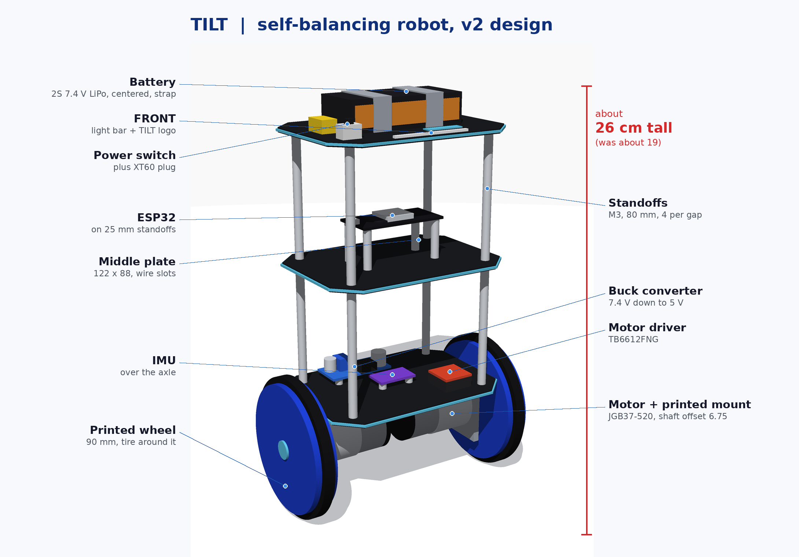
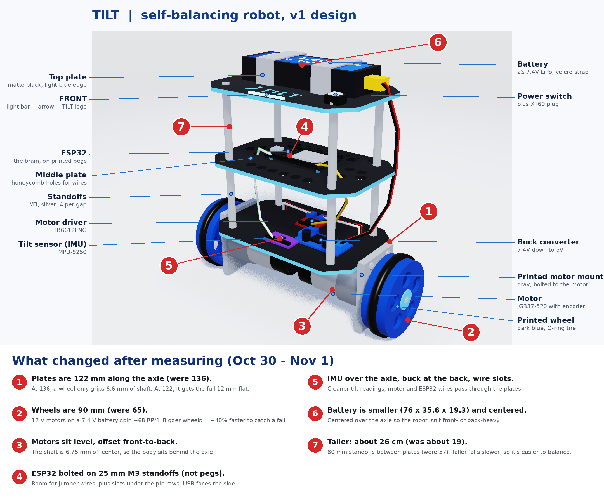
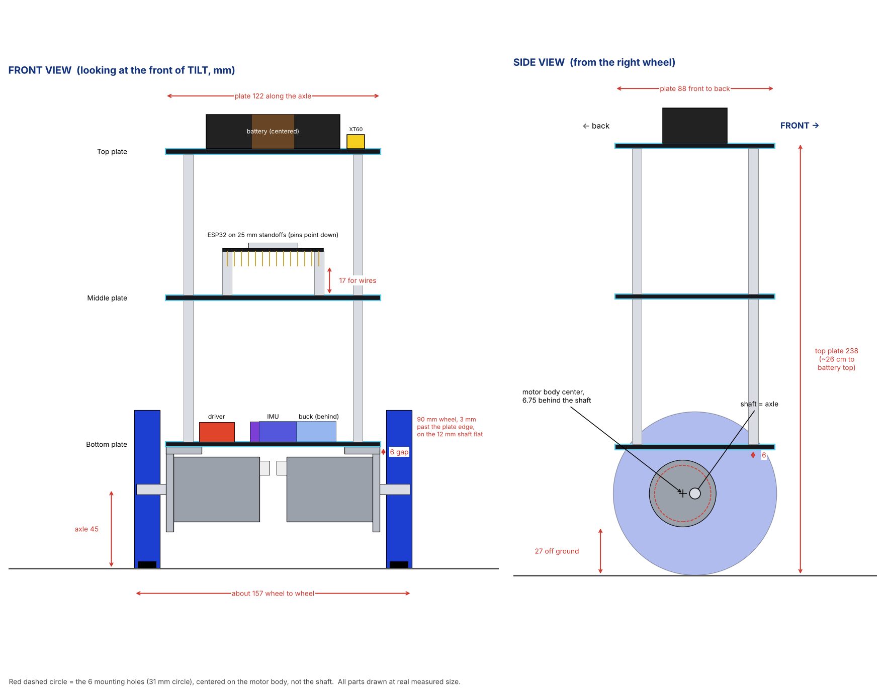
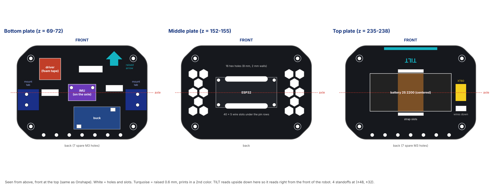
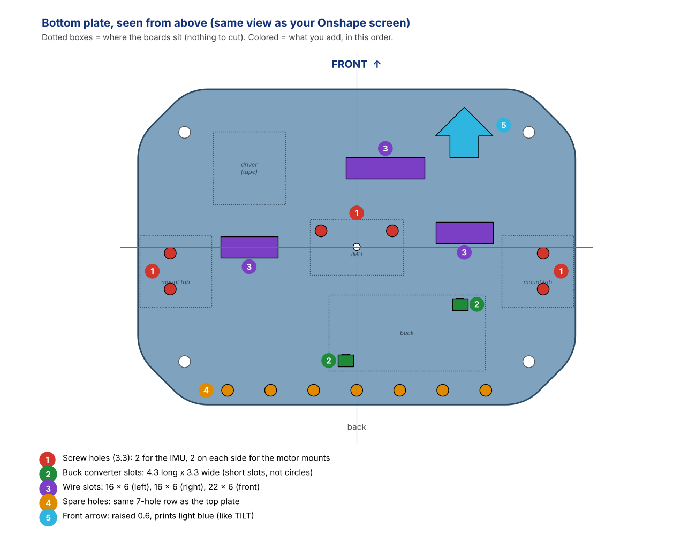
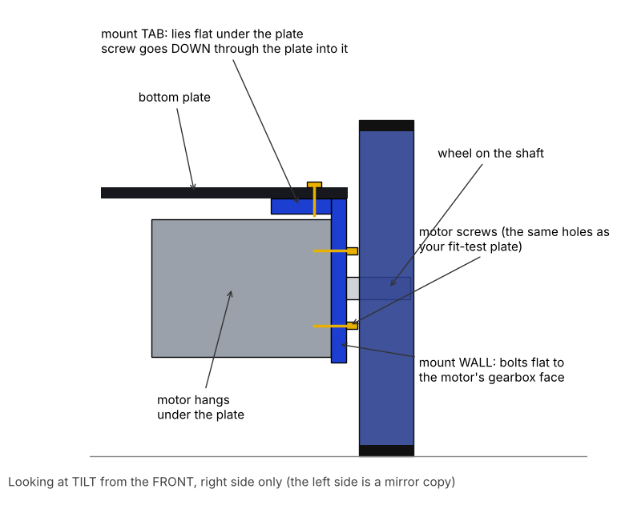
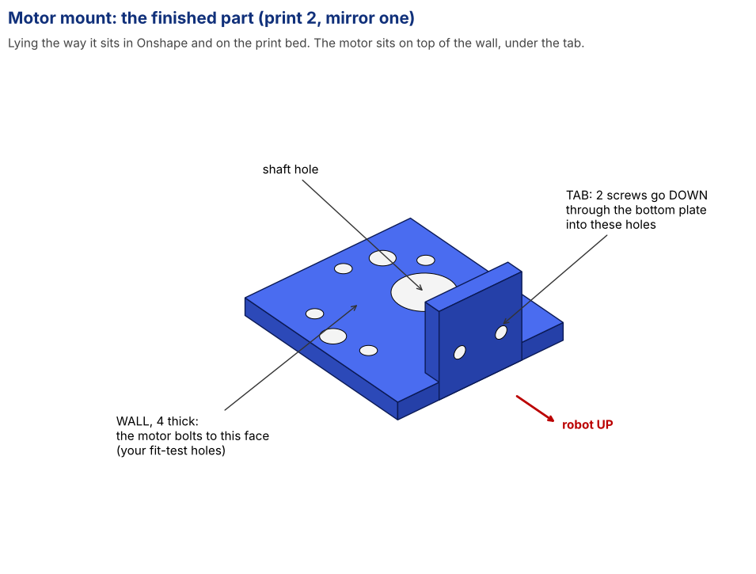

# TILT design (v2)

This is what TILT looks like now: about 26 cm tall, 90 mm wheels, and every part drawn at its measured size.

Once every part was measured (see [measurements.md](measurements.md)), I checked the first render against the real numbers. A few things didn't work, so I changed them before starting the CAD. All sizes are in mm.

## What changed and why

1. **Plates are 122 along the axle (were 136).** The wheels sit higher than the bottom plate, so they have to go outside its edge. At 136 wide, each wheel would only grip 6.6 mm of the motor shaft. At 122, it sits on the whole 12 mm flat, 3 mm past the plate edge.
2. **Wheels are 90 (were 65).** The motors are rated 110 RPM at 12 V, but my battery is 7.4 V, so they only spin about 68 RPM. A bigger wheel goes farther per turn: top speed goes from about 0.23 m/s to 0.32 m/s, which gives the robot more room to catch itself when it tips. The motors have plenty of torque for this.
3. **Motors sit level, with the offset pointing front to back.** The shaft is 6.75 off center on the motor face. If the offset pointed down, the motor would hit the bottom plate. Turned sideways, the body sits 6.75 behind the axle, with 6 mm of room under the plate and 27 mm off the ground.
4. **ESP32 is bolted down on 25 mm M3 standoffs (not printed pegs).** It has M3 holes, and its pins point down. 25 mm leaves about 17 mm under the pins for jumper wires, and the plate has slots under both pin rows so wires can go straight down. The USB port faces the side so I can plug in my laptop.
5. **IMU is in the center of the bottom plate, right over the axle.** That spot moves the least when the robot rocks, so the tilt readings are cleaner. Its X axis lines up with the axle. The buck converter moved to the back so it clears the standoffs and the motor mount tabs, and the bottom plate has slots for the motor wires.
6. **Battery is centered over the axle.** It's smaller than the render showed (76 x 35.6 x 19.3), and centering it keeps the robot from being front- or back-heavy.
7. **Taller: about 26 cm to the top of the battery (was about 19).** The standoffs between plates are 80 mm now instead of 57. A taller robot tips over more slowly, so the motors get more time to catch it, and it's more fun to watch. I didn't go taller than this because long standoffs start to wobble and it falls harder when I'm tuning. If Thinkbox doesn't have 80 mm standoffs, I can stack shorter M3 male-female ones.

## Front and side views

| | Height (mm) |
| --- | --- |
| Axle | 45 |
| Bottom plate | 69 to 72 |
| Middle plate | 152 to 155 |
| Top plate | 235 to 238 |
| Top of the battery | about 257 |
| Standoffs between plates | 80 long, M3 |

Keeping it tall is on purpose. A taller robot falls over more slowly, which gives slow motors more time to react.

## Each plate from above

- **Bottom:** IMU, motor driver (foam tape, no holes), buck converter, 2 motor mount tabs, wire slots, raised front arrow
- **Middle:** ESP32 (4 holes, 52.13 x 23.17), honeycomb holes, two 40 x 5 wire slots under the pin rows (12.7 from center). I first planned 46 long, but that ran into the ESP32's standoffs.
- **Top:** battery with strap slots, a hole for the battery wires, raised TILT logo and light bar at the front (no switch for now, I just unplug the XT60)
- Every plate: 4 standoff holes at (±48, ±32), a row of spare M3 holes along the back edge, and the same outline: 14 mm corner chamfers rounded with a 13 mm fillet, a 1 mm fillet on the top edge and a 0.6 mm chamfer on the bottom edge

## Part plans

Bottom plate, seen from above with the front at the top. Dotted boxes are where the boards sit.

How a motor attaches: an L-shaped mount bolts to the gearbox face, and its tab screws up into the bottom plate.

**Wheels:** 84 mm plastic wheel with a groove around the edge. A tire sits in the groove and brings it to 90 mm. The shaft hole is D-shaped to match the flat on the motor shaft.

**Colors and materials:** plates in black PLA with the raised logo, light bar and arrow in a second color. Wheels and motor mounts in PETG because they take the hits when it falls.

## Still to do

- [x] Measure hole to hole along the short side on the ESP32 and the buck converter (ESP32: 52.13 x 23.17, buck: see measurements.md, gets slots)
- [x] Tire plan: groove in the wheel, TPU tire or bike inner tube
- [x] Build it in Onshape (all parts designed Nov 7)
