# Nov 6, 2026: first Onshape parts and first prints

Today was my first real day in Onshape. I went from never using it to two printed parts. I learned by doing it on the actual robot instead of watching tutorials first.

## Part 1: motor fit-test plate

Before designing the real motor mount, I made a small test plate to check my motor measurements. The tricky part is that the motor shaft is 6.75 mm off center from the mounting holes, so I wanted to make sure I got that right before making anything bigger.

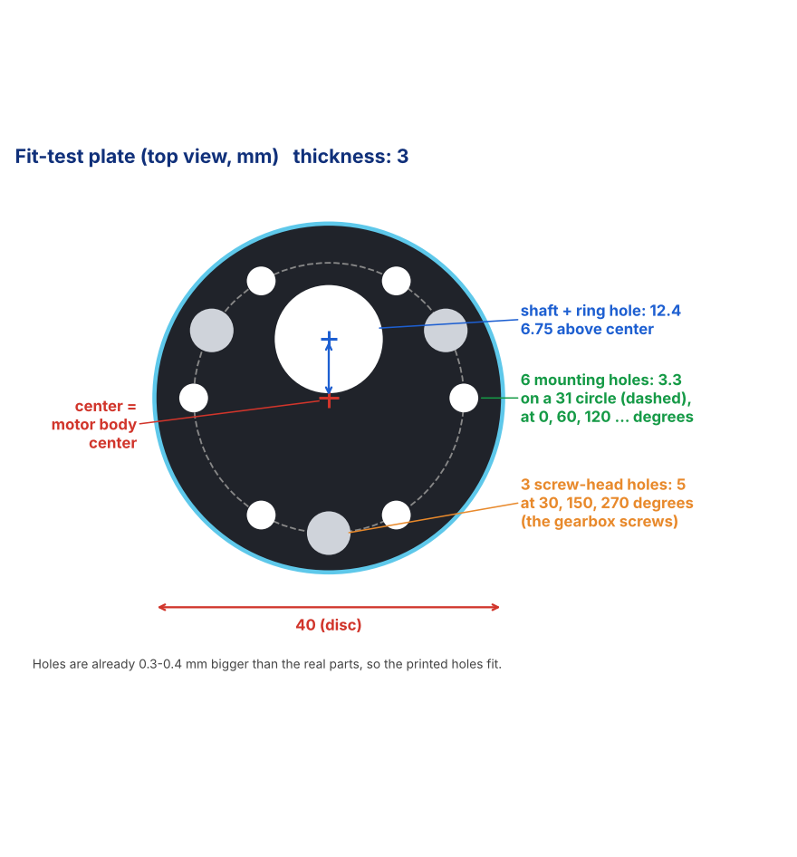

It's a 40 mm disc, 3 mm thick, with:
- 6 mounting holes (3.3 mm) on a 31 mm circle
- a 12.4 mm hole for the shaft and its raised ring, 6.75 mm off center
- 3 bigger holes (5 mm) so the gearbox screw heads don't stop it sitting flat

All the holes are about 0.3 mm bigger than the real parts, since 3D printers print holes a little small.

I used a dashed construction circle (31 mm) to place the holes, then a circular pattern to copy them around. Since I had one hole on each side already, a pattern of 3 gave me all 6.

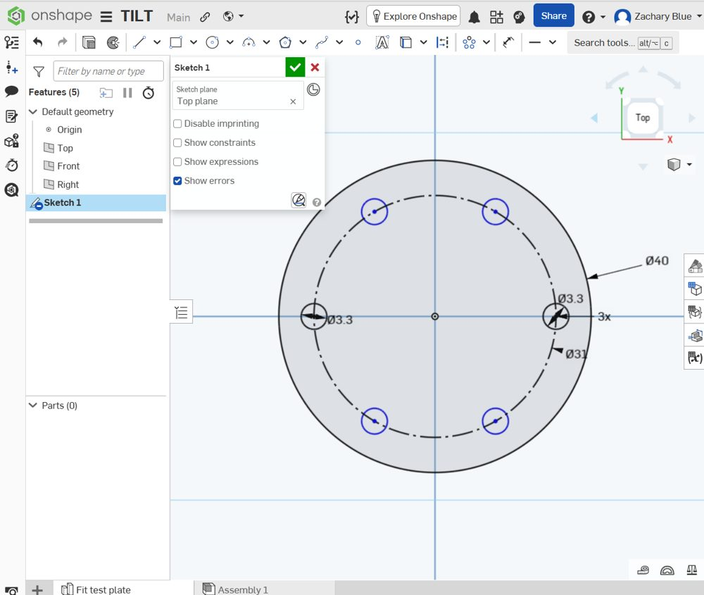

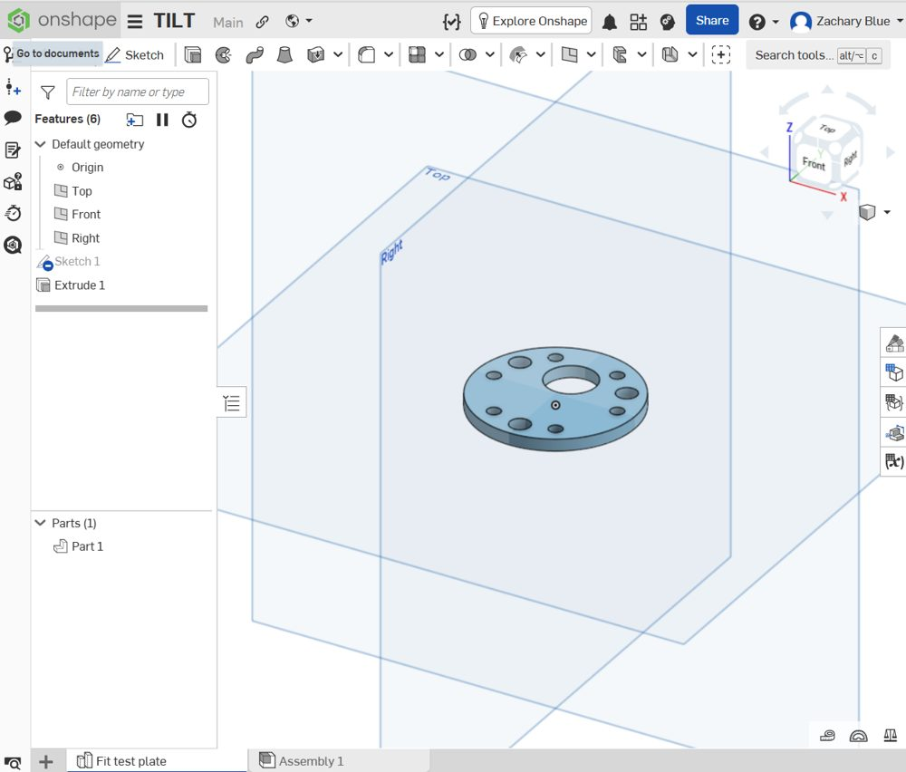

I printed it at Thinkbox (about 15 minutes) and I'm testing it on the motor tonight.

## Part 2: middle plate

All 3 plates start from the same base: a 122 x 88 mm, 3 mm thick plate with 4 standoff holes at (±48, ±32). I cut the corners with a 14 mm chamfer to get the shape from my render, then rounded those corners with a 13 mm fillet so it looks smoother.

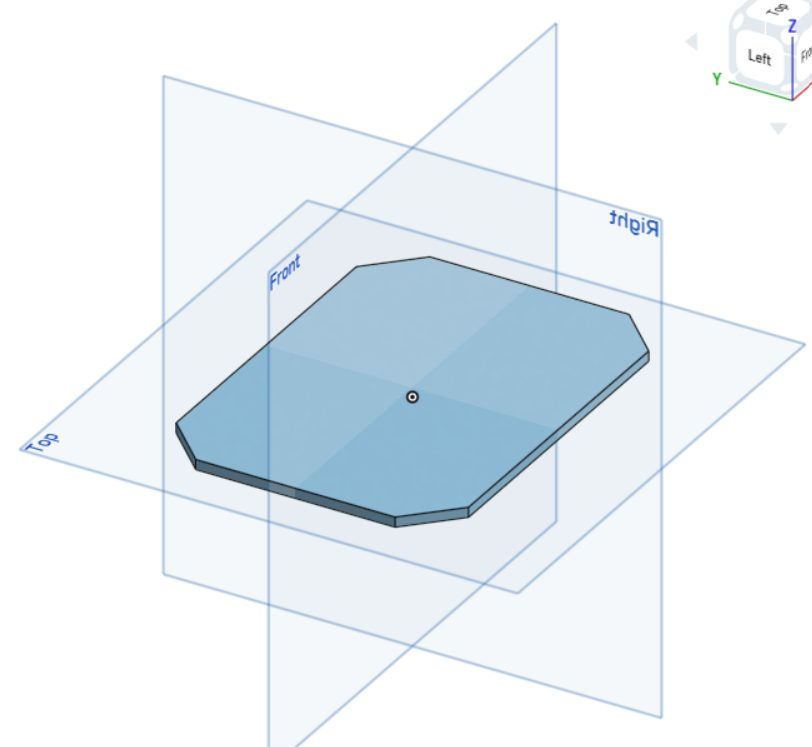

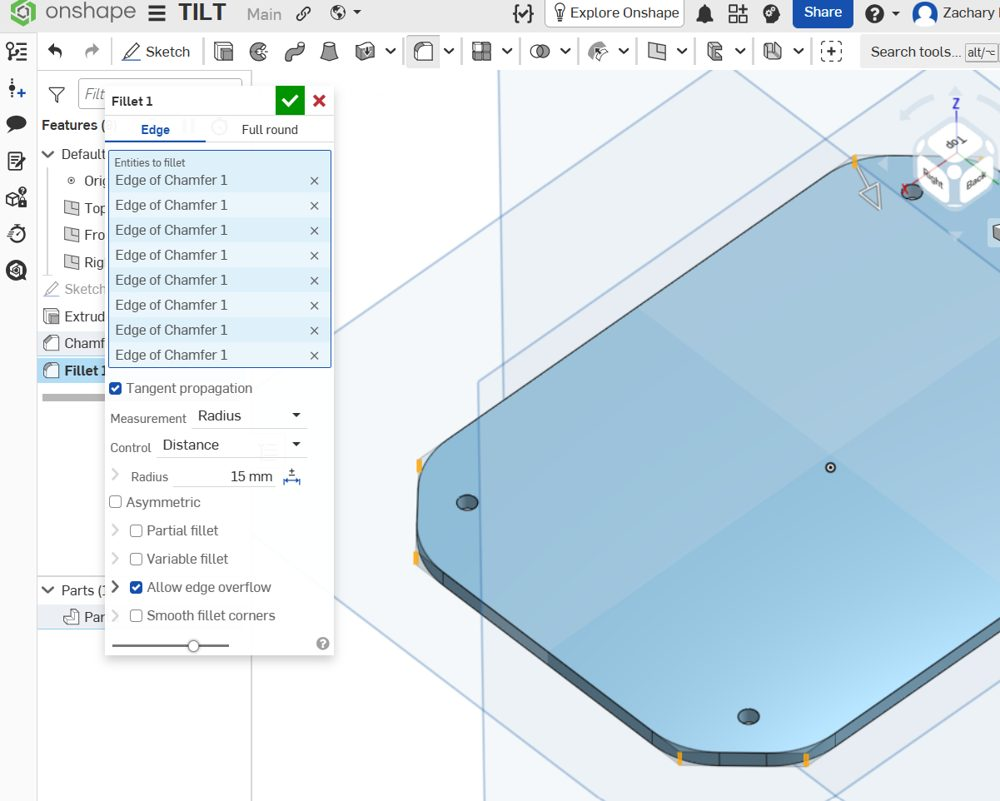

I also put a 1 mm fillet on the top edge and a 0.6 mm chamfer on the bottom edge. The bottom one is a chamfer and not a fillet because a rounded bottom edge would hang over nothing while printing.

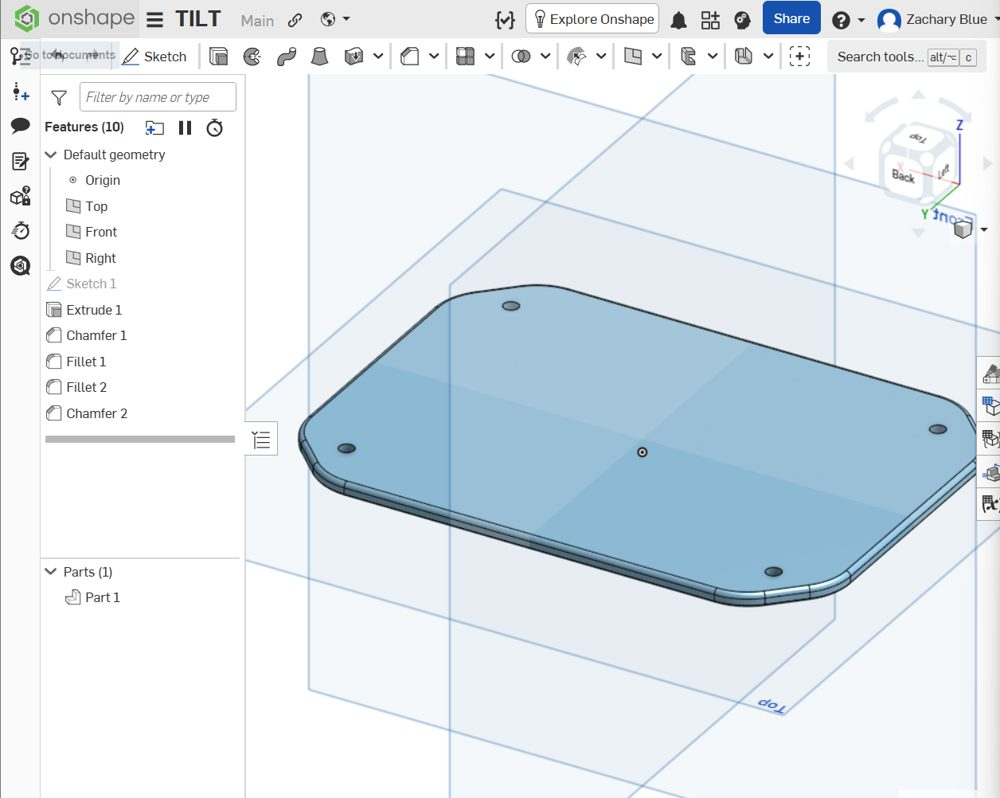

Then I made 3 copies of the base (bottom, middle, top) and started on the middle plate, which holds the ESP32.

**ESP32 holes and wire slots**
- 4 holes in a 52.13 x 23.17 rectangle (measured on my board)
- 2 wire slots, 40 x 5 mm, under the pin rows (12.7 mm from center), so wires can go straight down to the bottom plate

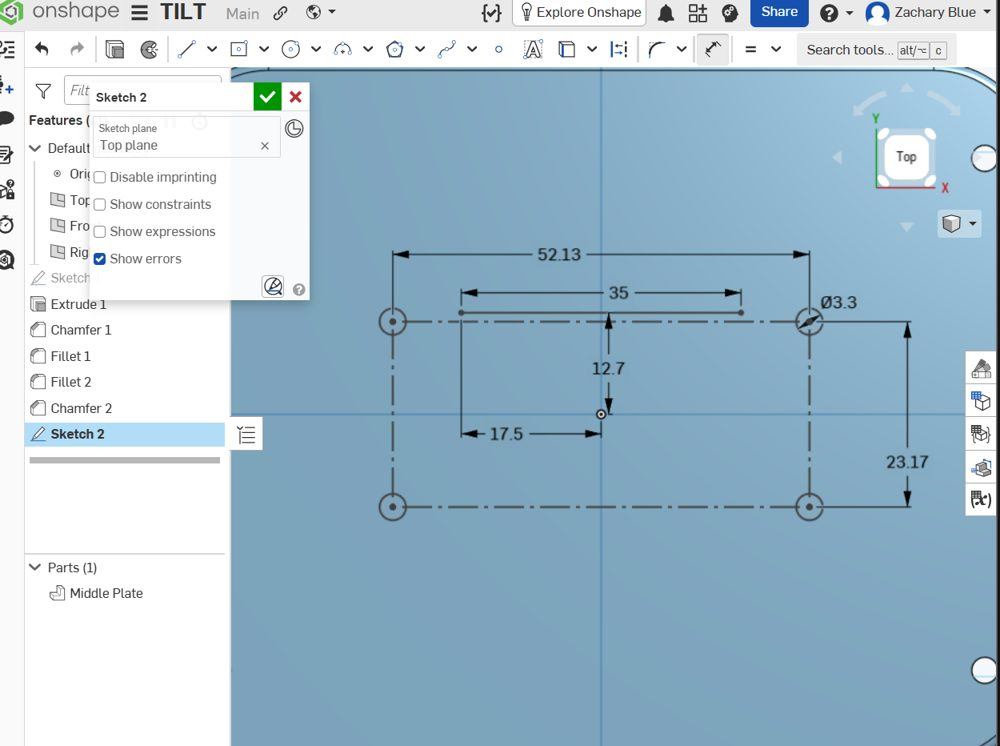

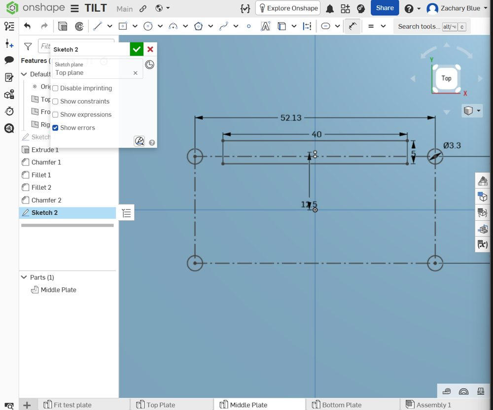

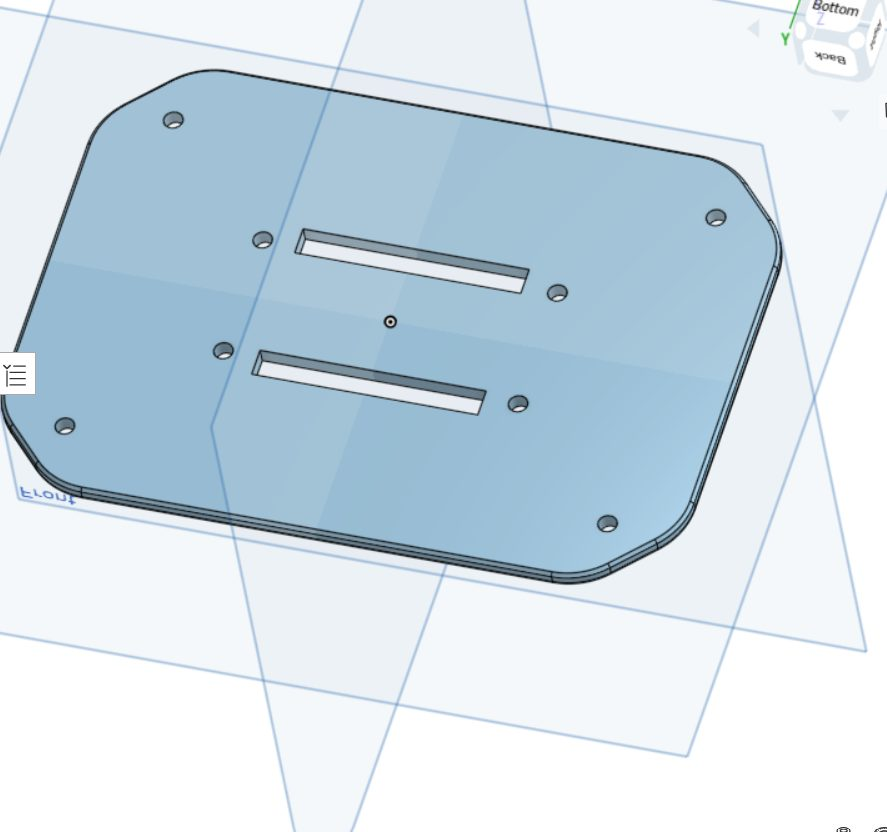

**Honeycomb**

16 hexagons, 8 mm across with 2 mm walls between them, 8 on each side of the ESP32. I made one hexagon, used a linear pattern to make a 2 x 3 grid, added 2 in the gaps to make it an actual honeycomb, then mirrored all 8 to the other side.

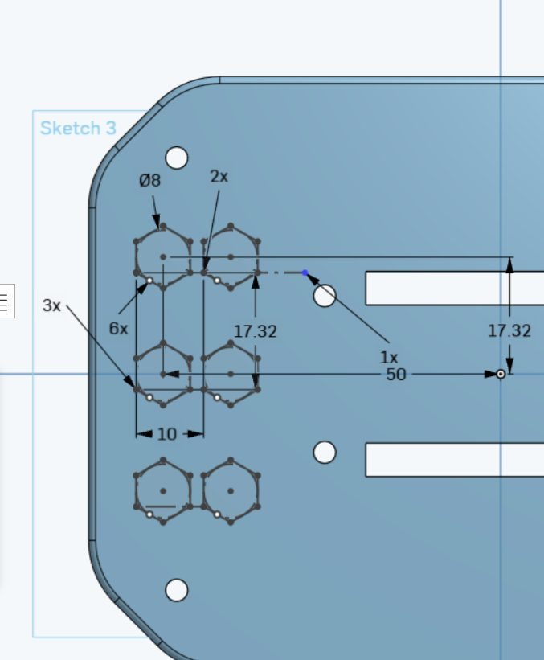

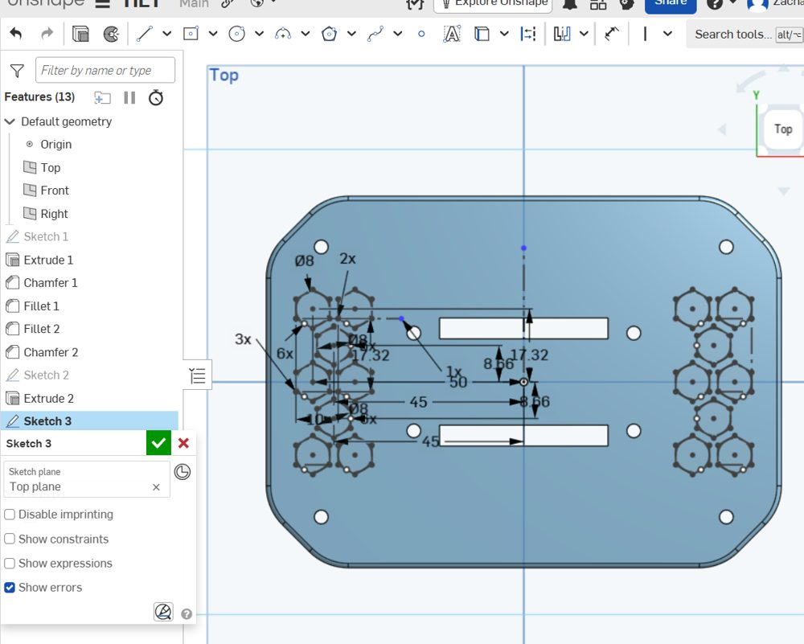

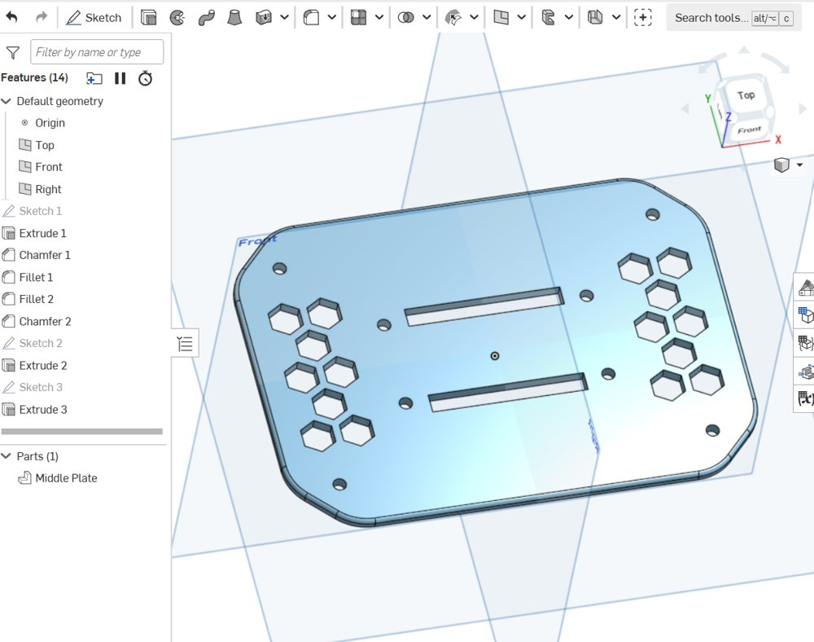

It's printing overnight in PLA (0.2 mm layers, 3 walls, 20% infill). Next time I'll screw the ESP32 onto it to check the holes.

## Things I messed up (and what fixed them)

- **Diagonal dimensions.** I dimensioned from a line's end to the origin and it measured on an angle, so the slot wasn't centered. Where you drag the mouse decides the type: above or below gives a sideways distance, left or right gives up and down.
- **Slot tool snapping.** The Slot tool kept grabbing the dashed line or snapping to nearby holes. I switched to a 40 x 5 rectangle instead, which works the same for wires.
- **Cut went the wrong way.** My first "remove through all" did nothing because it was cutting upward into air. When the sketch is on the top face, the cut has to be flipped to point down into the plate.
- **Slots were too long at first.** 46 mm ran into the ESP32's standoffs, so I shortened them to 40.
- **Blue lines.** Blue means something isn't locked yet. Dragging it shows what's missing (spins = needs vertical, grows = needs a size, slides = needs a position).

## Next

- Test the fit-test plate on the motor tonight
- Test the ESP32 on the middle plate
- CAD the bottom plate (IMU, buck converter, driver, motor mount tabs)
